# rust-next-voiler

**AI 駆動開発** 前提のフルスタック ボイラープレート。
要件定義 → 設計 → 実装 → テスト → 内部結合 → 負荷試験 → CI/CD → PR → レビュー → マージ を、
Claude Code のスキル (スラッシュコマンド) と GitHub Actions で一貫して回せる。

| 層 | 技術 |
|---|---|
| Backend | Rust, axum 0.8, sqlx 0.8, tokio |
| Frontend | Next.js 16 (App Router), React 19, TypeScript |
| DB | MySQL 8.4 |
| Infra | Docker / docker compose |
| Test | cargo test, `#[sqlx::test]`, Vitest + Testing Library, Playwright, k6 |
| CI/CD | GitHub Actions (CI, CD→GHCR, 負荷試験, Claude 自動レビュー) |

## 目次
- [クイックスタート](#クイックスタート)
- [システム構成](#システム構成)
- [エンドポイント一覧](#エンドポイント一覧)
- [シーケンス図](#シーケンス図)
- [ER 図](#er-図)
- [バックエンドのレイヤ構成](#バックエンドのレイヤ構成)
- [AI 駆動開発フロー](#ai-駆動開発フロー)
- [テスト戦略](#テスト戦略)
- [CI/CD](#cicd)
- [ディレクトリ](#ディレクトリ)

## クイックスタート
```bash
cp .env.example .env
make up            # mysql + backend(:8080) + frontend(:3000)
open http://localhost:3000
make e2e           # E2E
make loadtest      # k6 smoke
make down
```
ローカル開発 (ホットリロード):
```bash
make setup
make dev-backend   # 別ターミナル
make dev-frontend
```
`make help` で全コマンド。

## システム構成

ブラウザは常に **同一オリジン (`:3000`) の `/api/*`** を呼び、Next.js の rewrites がバックエンドへ転送する。
そのためブラウザ側で CORS を意識する必要がない。

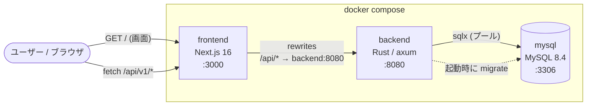

| サービス | ポート | 役割 | 依存 |
|---|---|---|---|
| `frontend` | 3000 | 画面配信と `/api/*` のプロキシ | backend |
| `backend` | 8080 | REST API、起動時にマイグレーション適用 | mysql (healthy になってから起動) |
| `mysql` | 3306 | 永続化 (`mysql-data` ボリューム) | — |

## エンドポイント一覧

ベース URL: バックエンド直 `http://localhost:8080` / フロント経由 `http://localhost:3000`
契約の正: [docs/api/openapi.yaml](docs/api/openapi.yaml)

| Method | Path | 説明 | リクエスト | 成功 | エラー |
|---|---|---|---|---|---|
| GET | `/healthz` | Liveness (プロセス生存) | — | `200 {"status":"ok"}` | — |
| GET | `/readyz` | Readiness (DB 疎通) | — | `200 {"status":"ready"}` | `503` |
| GET | `/api/v1/todos` | 一覧 (作成日時の降順) | query: `limit` 1〜100 (既定 50), `offset` ≥0 | `200 Todo[]` | `400` |
| POST | `/api/v1/todos` | 作成 | `{"title": string}` | `201 Todo` | `400` |
| GET | `/api/v1/todos/{id}` | 1 件取得 | path: `id` (UUID) | `200 Todo` | `400` `404` |
| PATCH | `/api/v1/todos/{id}` | 部分更新 | `{"title"?: string, "completed"?: boolean}` (1 項目以上) | `200 Todo` | `400` `404` |
| DELETE | `/api/v1/todos/{id}` | 削除 | path: `id` | `204` | `400` `404` |

**Todo**
```json
{
  "id": "906f7cee-9d29-4398-92a0-ba5641333beb",
  "title": "牛乳を買う",
  "completed": false,
  "createdAt": "2026-11-23T01:43:48.949977Z",
  "updatedAt": "2026-11-23T01:43:48.949977Z"
}
```

**エラー** (全エンドポイント共通)
```json
{ "code": "VALIDATION_ERROR", "message": "title must not be empty" }
```

| code | HTTP | 発生条件 |
|---|---|---|
| `VALIDATION_ERROR` | 400 | タイトルが空白のみ / 255 文字超 / PATCH の項目なし / 不正な UUID / 壊れた JSON |
| `NOT_FOUND` | 404 | 指定 ID が存在しない |
| `INTERNAL_ERROR` | 500 | DB 障害など (詳細はログのみに出し、レスポンスには含めない) |

```bash
# 例
curl -s -X POST localhost:8080/api/v1/todos -H 'content-type: application/json' -d '{"title":"牛乳を買う"}'
curl -s 'localhost:8080/api/v1/todos?limit=10'
curl -s -X PATCH localhost:8080/api/v1/todos/<id> -H 'content-type: application/json' -d '{"completed":true}'
curl -s -X DELETE localhost:8080/api/v1/todos/<id> -i
```

## シーケンス図

### Todo 作成 (正常系)
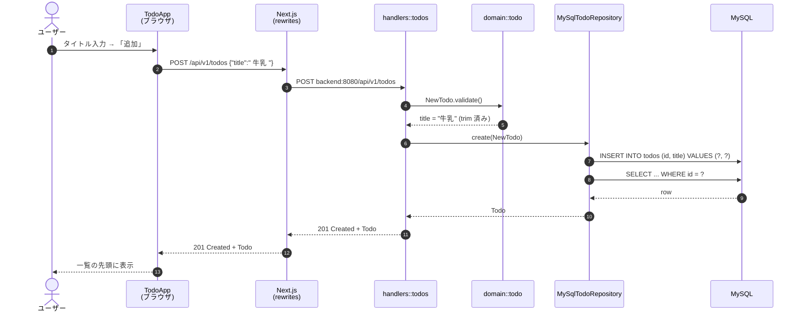

### 入力エラー (異常系)
入力の抽出失敗 (壊れた JSON・不正 UUID) もドメインのバリデーション失敗も、`AppError` を通して同じ JSON 形式で返る。

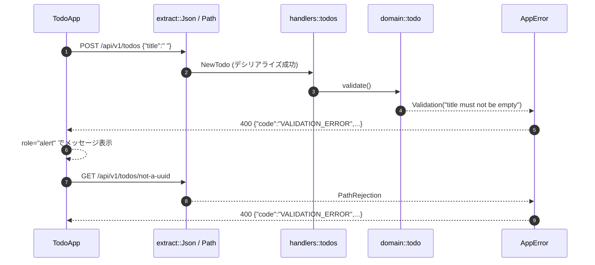

### 完了切替・削除と画面状態
画面はサーバ応答を受けてから state を更新する (楽観更新なし)。リロードしても DB の値が表示される。

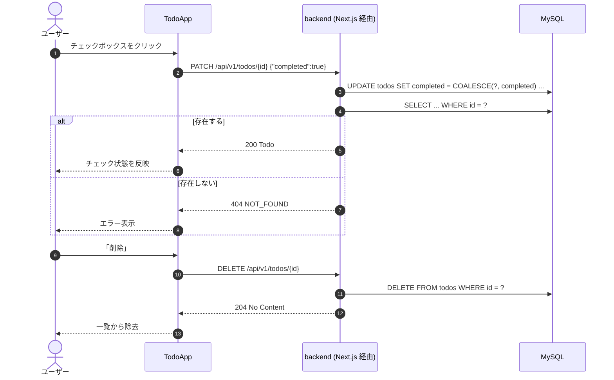

### 起動シーケンス
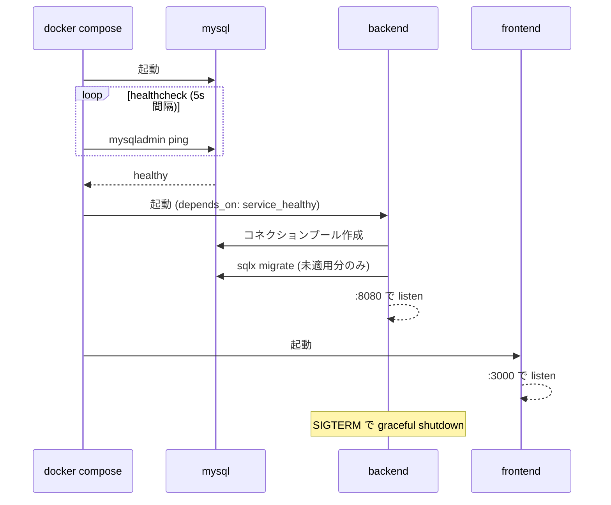

## ER 図

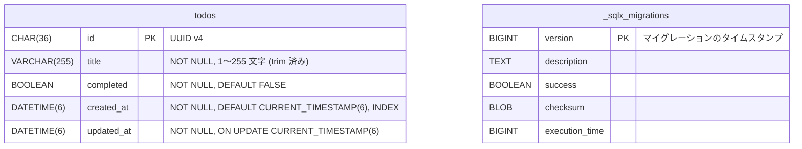

- `_sqlx_migrations` は sqlx が自動管理する適用履歴テーブル
- 文字コード `utf8mb4` / 照合順序 `utf8mb4_0900_ai_ci` / InnoDB / 日時は UTC
- マイグレーションは **追加のみ** (`backend/migrations/YYYYMMDDHHMMSS_name.sql`)。規約: [docs/db/schema.md](docs/db/schema.md)

リソースを追加するときのリレーション例 (未実装、拡張時の参考):
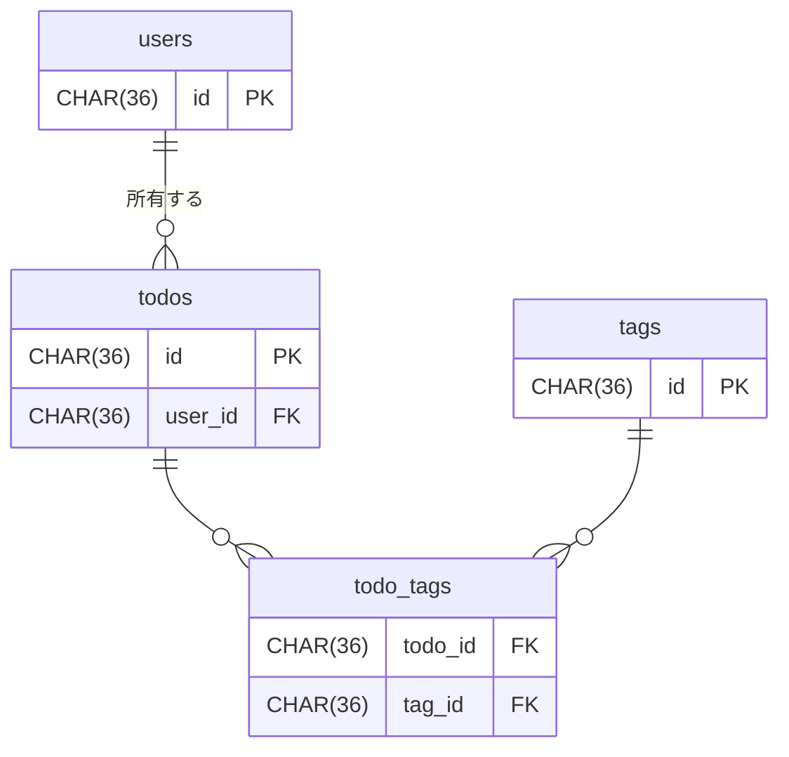

## バックエンドのレイヤ構成

依存は **handlers → domain → repository (trait)** の一方向。ハンドラは trait にしか依存しないので、
HTTP テストはインメモリ実装、結合テストは MySQL 実装に差し替えられる。

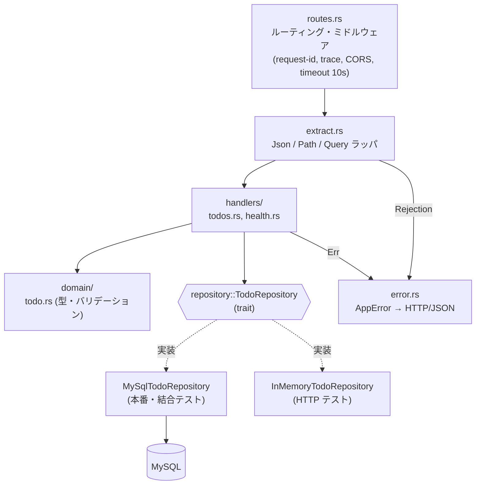

## AI 駆動開発フロー

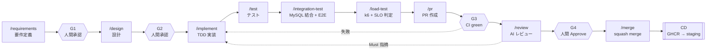

Claude Code でリポジトリを開き、`/feature タスクに期限日を追加したい` で一気通貫。フェーズごとに実行する場合:

| フェーズ | コマンド | 成果物 / ゲート |
|---|---|---|
| 要件定義 | `/requirements <説明>` | `docs/features/NNNN-slug/requirements.md` → **人間承認** |
| 設計 | `/design NNNN-slug` | `design.md`, `docs/api/openapi.yaml`, ADR → **人間承認** |
| 実装 | `/implement NNNN-slug` | TDD でコード + テスト |
| テスト | `/test NNNN-slug` | AC 網羅の単体/HTTP/コンポーネントテスト |
| 内部結合 | `/integration-test NNNN-slug` | MySQL 結合テスト + Playwright E2E |
| 負荷試験 | `/load-test NNNN-slug load` | `load-test-report.md` (SLO 判定) |
| PR | `/pr NNNN-slug` | テンプレート準拠の PR → **CI green** |
| レビュー | `/review <PR番号> --comment` | reviewer / security-reviewer エージェントによるレビュー |
| マージ | `/merge <PR番号>` | **人間 Approve 後のみ** squash merge → CD |

受入条件 ID (`AC-n`) を 要件 → 設計のトレーサビリティ表 → テスト名 → PR チェックリスト で共通に使う。
詳細: [docs/process/ai-driven-workflow.md](docs/process/ai-driven-workflow.md) / AI 向け規約: [CLAUDE.md](CLAUDE.md)

## テスト戦略

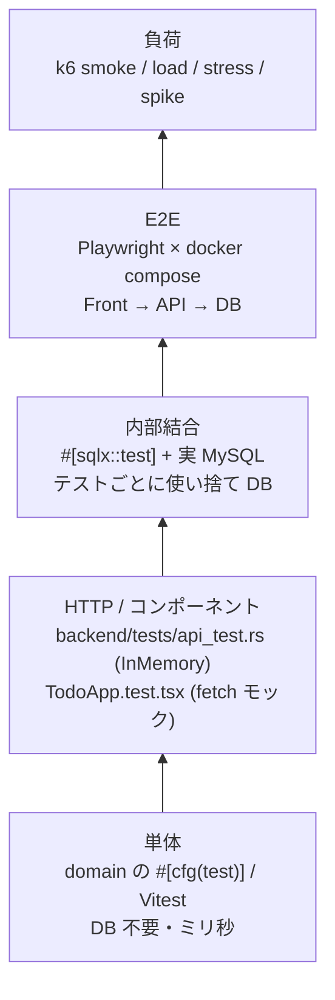

| 層 | コマンド | 場所 | CI |
|---|---|---|---|
| 単体 + HTTP + コンポーネント | `make test-unit` | `backend/src/**`, `backend/tests/api_test.rs`, `frontend/src/**/*.test.tsx` | 毎 PR |
| 内部結合 (MySQL) | `make test-integration` | `backend/tests/mysql_repository_test.rs` | 毎 PR |
| E2E | `make up && make e2e` | `frontend/e2e/` | 毎 PR |
| 負荷 | `make loadtest PROFILE=...` | `loadtest/scenarios/` | 毎 PR は smoke、load 以上は手動 / 毎週 |

SLO (k6 の閾値、`loadtest/lib/config.js`): **p95 < 200ms / p99 < 500ms / エラー率 < 1%**

## CI/CD

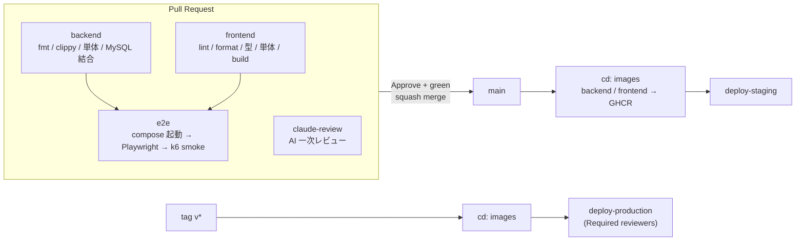

| ワークフロー | トリガ | 内容 |
|---|---|---|
| `ci.yml` | PR / main push | backend: fmt, clippy, 単体, MySQL 結合 / frontend: lint, format, 型, 単体, build / compose で E2E + k6 smoke |
| `claude-review.yml` | PR | Claude による自動一次レビュー |
| `claude.yml` | `@claude` メンション | Issue/PR 上で Claude が実装・修正 |
| `loadtest.yml` | 手動 / 毎週 | k6 load/stress/spike。結果を Job Summary に表示 |
| `cd.yml` | main / `v*` タグ | GHCR へイメージ push → staging / production (承認制) |

初期設定 (ブランチ保護・Secrets など): [docs/process/github-setup.md](docs/process/github-setup.md)

## ディレクトリ
```
backend/            Rust API (handlers → domain → repository)
  migrations/       sqlx マイグレーション (追加のみ)
  tests/            HTTP テスト / MySQL 結合テスト (--features integration)
frontend/           Next.js
  src/lib/api.ts    API クライアント (型は openapi.yaml と一致)
  e2e/              Playwright
loadtest/           k6 (scenarios/, lib/config.js に SLO 閾値)
docs/               プロセス, テンプレート, 機能別成果物, ADR, OpenAPI, DB
.claude/            skills (フェーズ別コマンド), agents (reviewer 等), hooks (自動整形), settings
.github/            CI/CD, PR/Issue テンプレート, Claude レビュー, dependabot
```
