# rust-next-voiler

**AI 駆動開発** 前提のフルスタック ボイラープレート。
要件定義 → 設計 → 実装 → テスト → 内部結合 → 負荷試験 → CI/CD → PR → レビュー → マージ を、
Claude Code のスキル (スラッシュコマンド) と GitHub Actions で一貫して回せる。
オンライン API に加えて、**大量データのバッチ処理基盤** (チャンク処理・再試行・再開・多重起動防止) を備える。

| 層 | 技術 |
|---|---|
| Backend | Rust (Cargo workspace), axum 0.8, sqlx 0.8, tokio |
| Batch | Rust CLI (clap) — backend と domain / repository を共有 |
| Frontend | Next.js 16 (App Router), React 19, TypeScript |
| DB | MySQL 8.4 (主キー UUID v7 / `BINARY(16)`, keyset ページネーション) |
| Infra | Docker / docker compose |
| Test | cargo test, `#[sqlx::test]`, Vitest + Testing Library, Playwright, k6 |
| CI/CD | GitHub Actions (CI, CD→GHCR, 負荷試験, Claude 自動レビュー) |

## 目次
- [クイックスタート](#クイックスタート)
- [システム構成](#システム構成)
- [エンドポイント一覧](#エンドポイント一覧)
- [シーケンス図](#シーケンス図)
- [ER 図](#er-図)
- [バックエンドの構成](#バックエンドの構成)
- [バッチ処理](#バッチ処理)
- [AI 駆動開発フロー](#ai-駆動開発フロー)
- [テスト戦略](#テスト戦略)
- [CI/CD](#cicd)
- [ディレクトリ](#ディレクトリ)

## クイックスタート
```bash
cp .env.example .env
make up            # mysql + backend(:8080) + frontend(:3000)
open http://localhost:3000
make e2e           # E2E
make loadtest      # k6 smoke
make down          # 停止 (make clean で DB ボリュームも削除)
```
バッチ:
```bash
docker compose run --rm batch seed --count 100000          # テストデータ投入
docker compose run --rm batch --dry-run archive-completed --older-than-days 30
docker compose run --rm batch archive-completed --older-than-days 30
docker compose run --rm batch status                       # 実行履歴
make batch-bench                                           # 100 万行で性能計測
```
ローカル開発 (ホットリロード):
```bash
make setup
make dev-backend   # 別ターミナル
make dev-frontend
```
`make help` で全コマンド。

## システム構成

ブラウザは常に **同一オリジン (`:3000`) の `/api/*`** を呼び、Next.js の Route Handler がバックエンドへ転送する。
転送先は実行時の環境変数 `API_ORIGIN` で決まるので、同じイメージを staging → production へ昇格できる。
バッチは backend と同じイメージの別バイナリ (`/app/batch`) で、スケジューラから起動する。

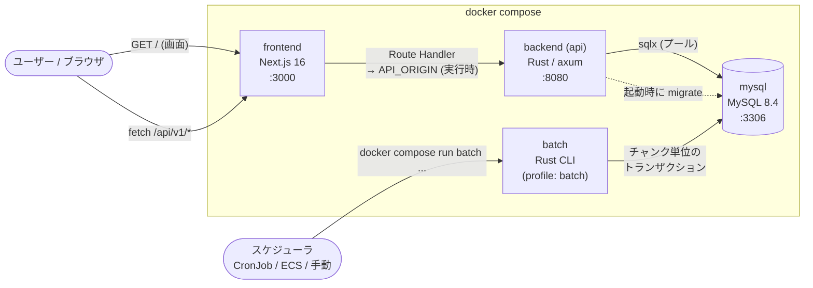

| サービス | ポート | 役割 | 依存 |
|---|---|---|---|
| `frontend` | 3000 | 画面配信と `/api/*` のプロキシ | backend |
| `backend` | 8080 | REST API、起動時にマイグレーション適用 | mysql (healthy になってから起動) |
| `batch` | — | バッチ CLI (`profiles: [batch]`、`docker compose run` で都度起動) | mysql |
| `mysql` | 3306 | 永続化 (`mysql-data` ボリューム) | — |

## エンドポイント一覧

ベース URL: バックエンド直 `http://localhost:8080` / フロント経由 `http://localhost:3000`
契約の正: [docs/api/openapi.yaml](docs/api/openapi.yaml)

| Method | Path | 説明 | リクエスト | 成功 | エラー |
|---|---|---|---|---|---|
| GET | `/healthz` | Liveness (プロセス生存) | — | `200 {"status":"ok"}` | — |
| GET | `/readyz` | Readiness (DB 疎通) | — | `200 {"status":"ready"}` | `503` |
| GET | `/api/v1/todos` | 一覧 (新しい順, カーソルページネーション) | query: `limit` 1〜100 (既定 50), `cursor` (前ページの `nextCursor`) | `200 TodoPage` | `400` |
| POST | `/api/v1/todos` | 作成 | `{"title": string}` | `201 Todo` | `400` |
| GET | `/api/v1/todos/{id}` | 1 件取得 | path: `id` (UUID) | `200 Todo` | `400` `404` |
| PATCH | `/api/v1/todos/{id}` | 部分更新 | `{"title"?: string, "completed"?: boolean}` (1 項目以上) | `200 Todo` | `400` `404` |
| DELETE | `/api/v1/todos/{id}` | 削除 | path: `id` | `204` | `400` `404` |

**Todo** (`id` は UUID v7。先頭が時刻なので ID 順 = 作成順)
```json
{
  "id": "01a20624-e391-73b1-b502-c3b1e9264685",
  "title": "牛乳を買う",
  "completed": false,
  "createdAt": "2026-11-23T01:43:48.949977Z",
  "updatedAt": "2026-11-23T01:43:48.949977Z"
}
```

**TodoPage** (`nextCursor` が `null` なら最終ページ)
```json
{ "items": [ /* Todo ... */ ], "nextCursor": "01a20624-e371-775c-86a7-4aea0be49fc8" }
```

**エラー** (全エンドポイント共通)
```json
{ "code": "VALIDATION_ERROR", "message": "title must not be empty" }
```

| code | HTTP | 発生条件 |
|---|---|---|
| `VALIDATION_ERROR` | 400 | タイトルが空白のみ / 255 文字超 / PATCH の項目なし / 不正な UUID・cursor / 壊れた JSON |
| `NOT_FOUND` | 404 | 指定 ID が存在しない |
| `INTERNAL_ERROR` | 500 | DB 障害など (詳細はログのみに出し、レスポンスには含めない) |
| `BAD_GATEWAY` | 502 | フロント経由時にバックエンドへ到達できない (Route Handler が返す) |

```bash
# 例
curl -s -X POST localhost:8080/api/v1/todos -H 'content-type: application/json' -d '{"title":"牛乳を買う"}'
curl -s 'localhost:8080/api/v1/todos?limit=10'
curl -s 'localhost:8080/api/v1/todos?limit=10&cursor=<nextCursor>'
curl -s -X PATCH localhost:8080/api/v1/todos/<id> -H 'content-type: application/json' -d '{"completed":true}'
curl -s -X DELETE localhost:8080/api/v1/todos/<id> -i
```

## シーケンス図

### Todo 作成 (正常系)
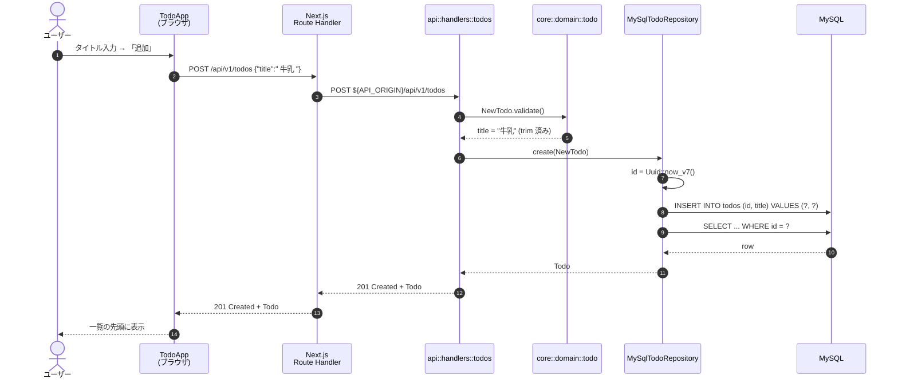

### 一覧のページ送り (keyset ページネーション)
`OFFSET` を使わず主キーの範囲検索にするので、何ページ目でも読む行数は `limit + 1` 件で一定。
(実測: 75 万行の深いページで OFFSET 280ms → keyset 3ms)

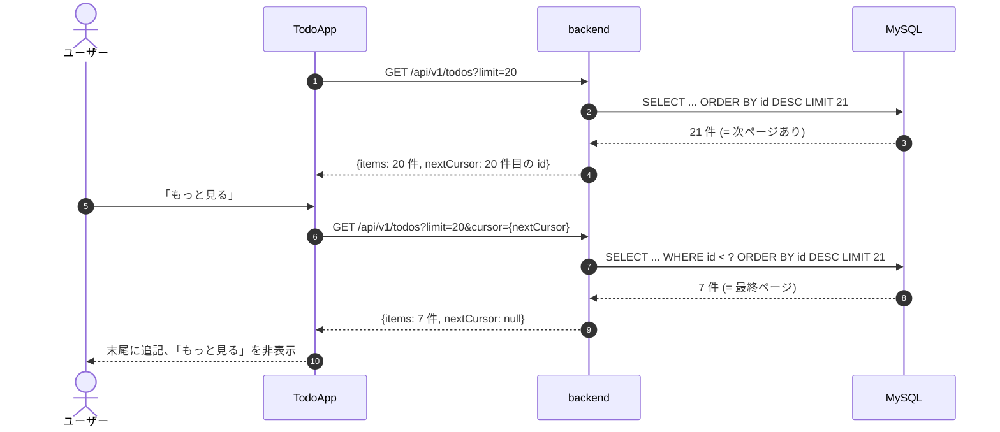

### 入力エラー (異常系)
入力の抽出失敗 (壊れた JSON・不正 UUID) もドメインのバリデーション失敗も、`ApiError` を通して同じ JSON 形式で返る。

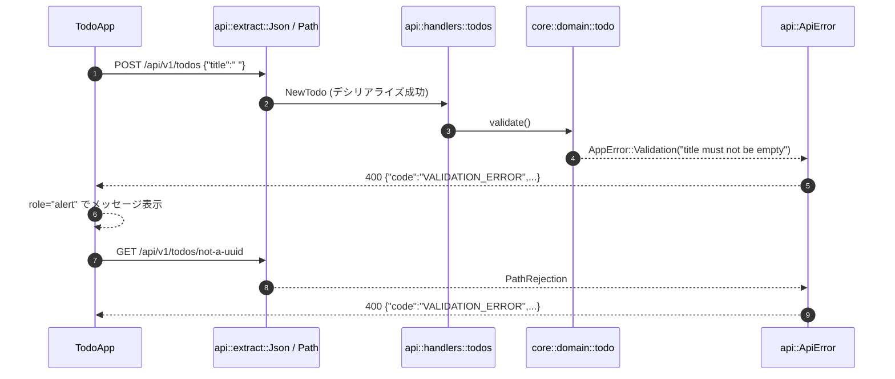

### 完了切替・削除と画面状態
画面はサーバ応答を受けてから state を更新する (楽観更新なし)。リロードしても DB の値が表示される。

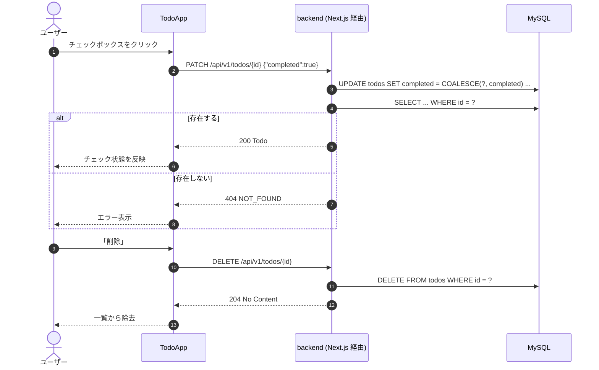

### 起動シーケンス
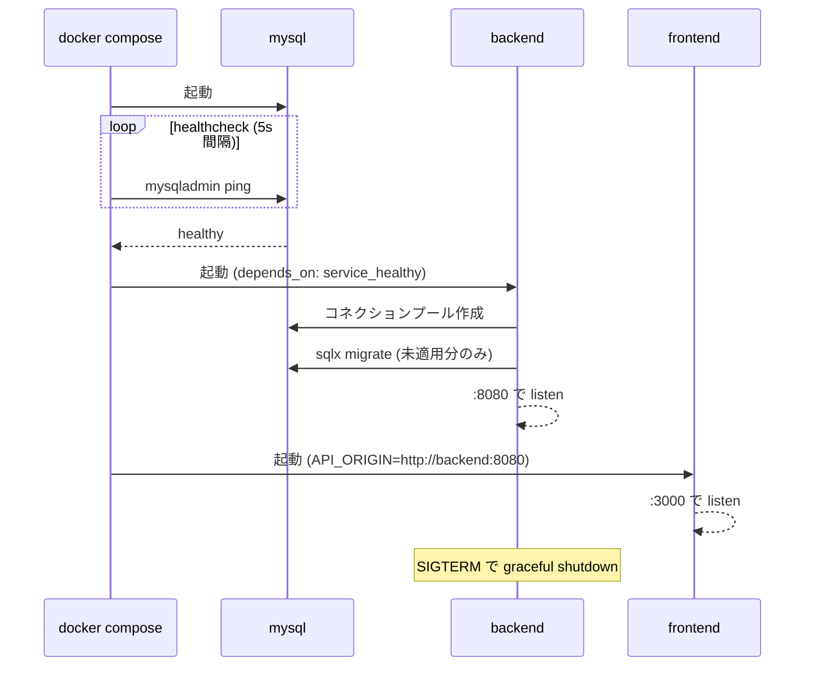

バッチのシーケンスは [バッチ処理](#バッチ処理) を参照。

## ER 図

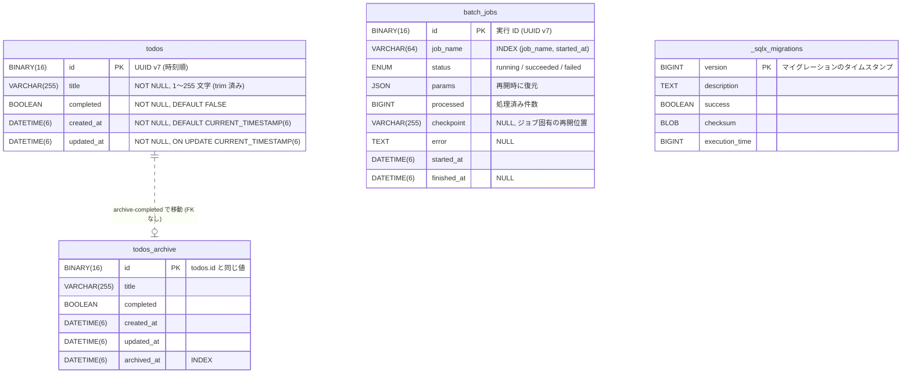

| テーブル | インデックス | 用途 |
|---|---|---|
| `todos` | PK `id` | 一覧の keyset ページネーション (`WHERE id < ? ORDER BY id DESC`) |
| `todos` | `idx_todos_completed_updated (completed, updated_at, id)` | アーカイブ対象の範囲検索 |
| `todos_archive` | PK `id`, `archived_at` | `INSERT IGNORE` による冪等な移動、保持期間での削除 |
| `batch_jobs` | `(job_name, started_at)` | ジョブ別の履歴参照 |

- 主キーは **UUID v7 を `BINARY(16)`**: 時刻順なので InnoDB のクラスタ化インデックスに末尾追記され、ランダムな v4 のようなページ分割が起きない
- `_sqlx_migrations` は sqlx が自動管理する適用履歴テーブル
- 文字コード `utf8mb4` / 照合順序 `utf8mb4_0900_ai_ci` / InnoDB / 日時は UTC
- マイグレーションは **追加のみ** (`backend/migrations/YYYYMMDDHHMMSS_name.sql`)。規約: [docs/db/schema.md](docs/db/schema.md)

リソースを追加するときのリレーション例 (未実装、拡張時の参考):
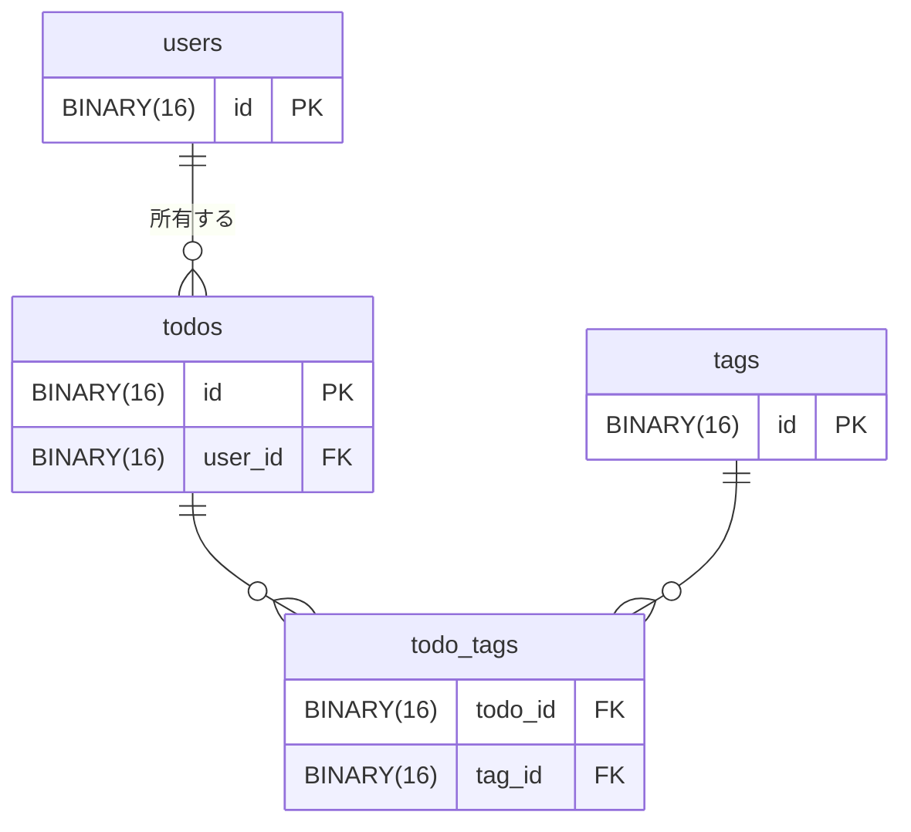

## バックエンドの構成

Cargo workspace で 3 クレートに分かれる。`app-core` は HTTP (axum) に依存しないため、API とバッチの両方から使える。

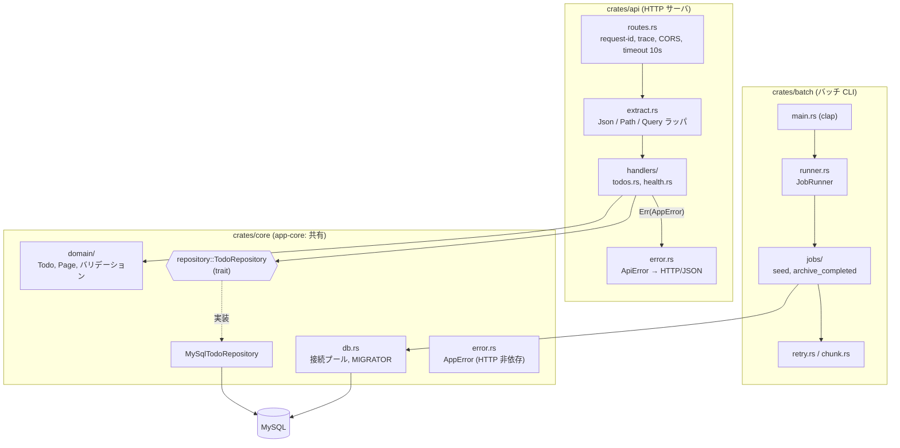

- HTTP テストはインメモリ実装 (`crates/api/tests/common/`、本番バイナリには含めない) に差し替えて DB なしで実行
- 結合テストは `#[sqlx::test]` で実 MySQL (`crates/core/tests/`, `crates/batch/tests/`)

## バッチ処理

API と同じ domain / DB 接続を使う独立バイナリ。共通の **JobRunner** が、多重起動防止・実行履歴・進捗とチェックポイントの保存・失敗時の再開を担い、
個々のジョブは `Job` trait を実装するだけでよい。運用ガイド: [docs/process/batch-operations.md](docs/process/batch-operations.md)

| コマンド | 内容 |
|---|---|
| `batch seed --count N [--chunk-size 1000] [--concurrency 4]` | テストデータをバルク INSERT (性能試験用) |
| `batch archive-completed --older-than-days N [--chunk-size 1000]` | 完了済みの古い Todo を `todos_archive` へ移動 |
| `batch --dry-run <job> ...` | 対象件数の確認のみ (変更なし・履歴なし) |
| `batch resume <RUN_ID>` | 失敗した実行をチェックポイントから再開 |
| `batch status` | 直近の実行履歴 |

| 仕組み | 実装 |
|---|---|
| 多重起動防止 | 専用コネクションで `GET_LOCK` (プロセスが落ちれば MySQL が自動解放) |
| チャンク処理 | 1 チャンク = 1 トランザクション。全件をメモリに載せない |
| バルク INSERT | `QueryBuilder::push_values`。1 文の行数をプレースホルダ上限 65,535 内に自動調整 |
| 再試行 | デッドロック (1213)・ロック待ち (1205)・接続断のみ指数バックオフで最大 5 回 |
| 冪等性 / 再開 | `INSERT IGNORE` + 処理済み行が対象外になる設計、または checkpoint (keyset 位置・件数) |
| オンラインへの配慮 | `FOR UPDATE SKIP LOCKED` で API の更新と競合しない |

### JobRunner の実行シーケンス
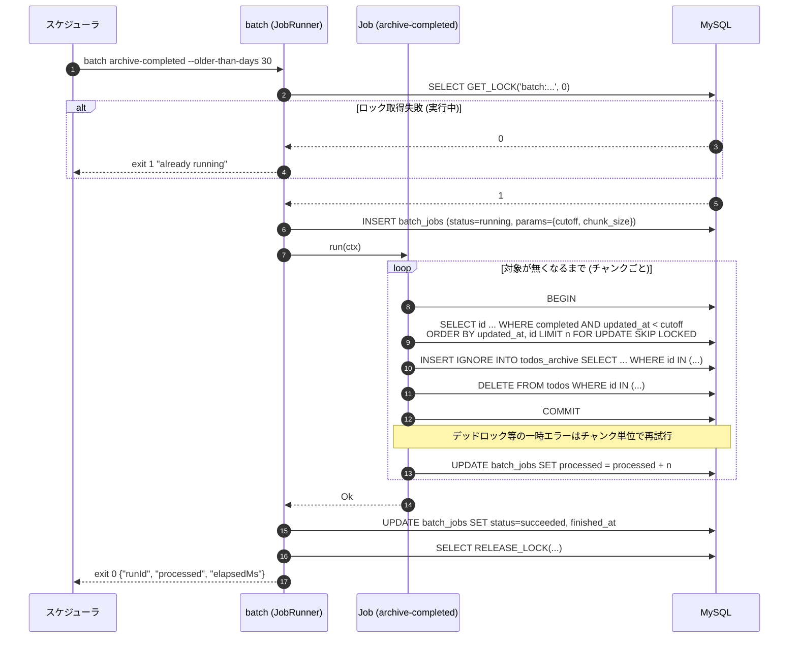

### 失敗と再開
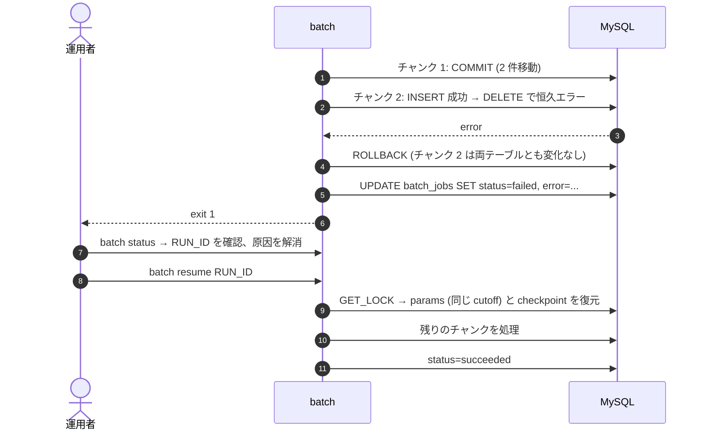

### 実行状態の遷移 (`batch_jobs.status`)
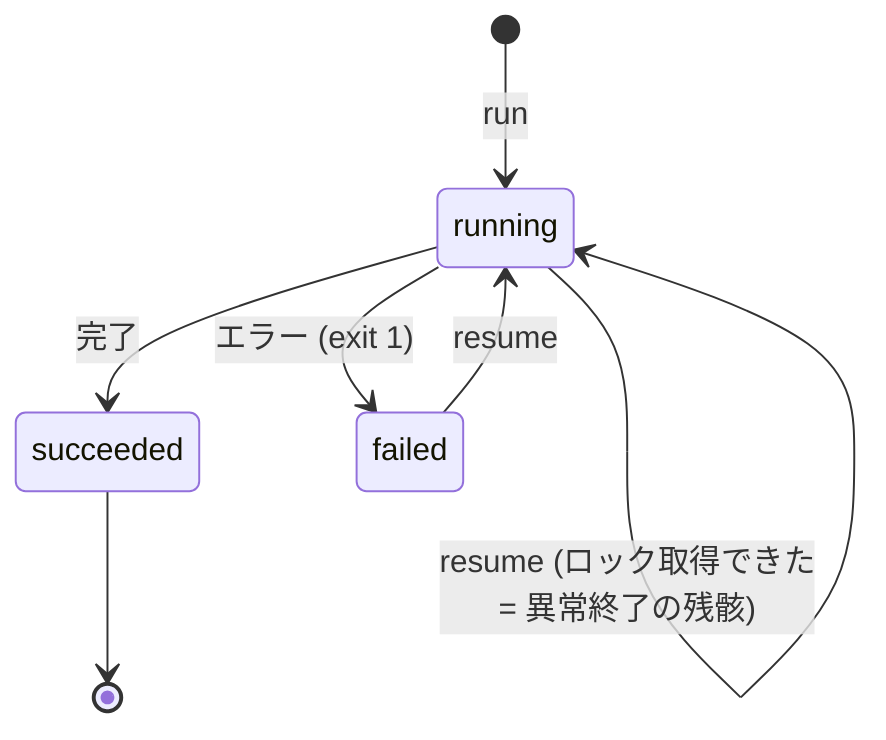

### 性能 (ローカル 4 vCPU, MySQL 既定設定)
| 処理 | 件数 | 所要時間 |
|---|---|---|
| seed (2,000 行/文 × 並列 4) | 1,000,000 | 8.0 s |
| archive-completed (chunk 2,000) | 253,596 | 6.7 s |
| archive 実行中の API (k6 50 VU) | — | p95 7.3 → 16.1 ms / p99 17.8 → 55.4 ms / エラー 0% |

詳細: [docs/features/0002-batch-foundation/load-test-report.md](docs/features/0002-batch-foundation/load-test-report.md)

## AI 駆動開発フロー

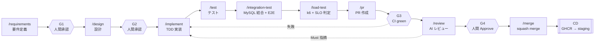

Claude Code でリポジトリを開き、`/feature タスクに期限日を追加したい` で一気通貫。フェーズごとに実行する場合:

| フェーズ | コマンド | 成果物 / ゲート |
|---|---|---|
| 要件定義 | `/requirements <説明>` | `docs/features/NNNN-slug/requirements.md` → **人間承認** |
| 設計 | `/design NNNN-slug` | `design.md`, `docs/api/openapi.yaml`, ADR → **人間承認** |
| 実装 | `/implement NNNN-slug` | TDD でコード + テスト |
| テスト | `/test NNNN-slug` | AC 網羅の単体/HTTP/コンポーネントテスト |
| 内部結合 | `/integration-test NNNN-slug` | MySQL 結合テスト + Playwright E2E |
| 負荷試験 | `/load-test NNNN-slug load` | `load-test-report.md` (SLO 判定、バッチは `make batch-bench`) |
| PR | `/pr NNNN-slug` | テンプレート準拠の PR → **CI green** |
| レビュー | `/review <PR番号> --comment` | reviewer / security-reviewer エージェントによるレビュー |
| マージ | `/merge <PR番号>` | **人間 Approve 後のみ** squash merge → CD |

受入条件 ID (`AC-n`) を 要件 → 設計のトレーサビリティ表 → テスト名 → PR チェックリスト で共通に使う。
このフローで作った実例: [docs/features/](docs/features/) (`0001-todo-crud`, `0002-batch-foundation`)
詳細: [docs/process/ai-driven-workflow.md](docs/process/ai-driven-workflow.md) / AI 向け規約: [CLAUDE.md](CLAUDE.md)

## テスト戦略

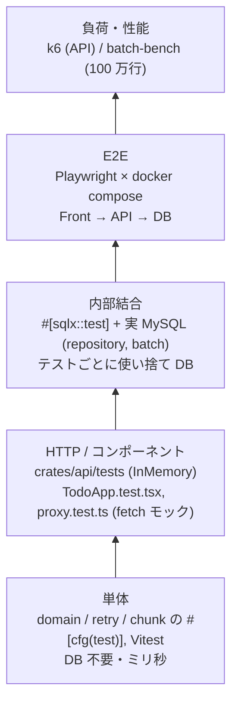

| 層 | コマンド | 場所 | CI |
|---|---|---|---|
| 単体 + HTTP + コンポーネント | `make test-unit` | `backend/crates/*/src`, `crates/api/tests/`, `frontend/src/**/*.test.ts(x)` | 毎 PR |
| 内部結合 (MySQL) | `make test-integration` | `crates/core/tests/`, `crates/batch/tests/` | 毎 PR |
| E2E | `make up && make e2e` | `frontend/e2e/` | 毎 PR |
| 負荷 (API) | `make loadtest PROFILE=...` | `loadtest/scenarios/` | 毎 PR は smoke、load 以上は手動 / 毎週 |
| バッチ | `make batch-bench` | `Makefile` | 毎 PR はコンテナで smoke (2 万行) |

SLO (k6 の閾値、`loadtest/lib/config.js`): **p95 < 200ms / p99 < 500ms / エラー率 < 1%**

バッチの結合テストは、トリガで DELETE を失敗させる **障害注入** で「チャンク単位の原子性」と「再開」を検証している。

## CI/CD

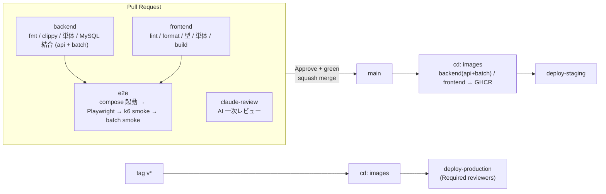

| ワークフロー | トリガ | 内容 |
|---|---|---|
| `ci.yml` | PR / main push | backend: fmt, clippy, 単体, MySQL 結合 / frontend: lint, format, 型, 単体, build / compose で E2E + k6 smoke + batch smoke |
| `claude-review.yml` | PR | Claude による自動一次レビュー |
| `claude.yml` | `@claude` メンション | Issue/PR 上で Claude が実装・修正 |
| `loadtest.yml` | 手動 / 毎週 | k6 load/stress/spike。結果を Job Summary に表示 |
| `cd.yml` | main / `v*` タグ | GHCR へイメージ push → staging / production (承認制) |

初期設定 (ブランチ保護・Secrets など): [docs/process/github-setup.md](docs/process/github-setup.md)

## ディレクトリ
```
backend/                 Rust workspace
  crates/core/           app-core: domain, repository, DB 接続 (API/バッチ共有)
  crates/api/            HTTP API (axum)。tests/ に HTTP テスト
  crates/batch/          バッチ CLI。src/jobs/ にジョブ、tests/ に結合テスト
  migrations/            sqlx マイグレーション (追加のみ)
  Dockerfile             api + batch を 1 イメージに
frontend/                Next.js
  src/app/api/[...path]/ バックエンドへのプロキシ (Route Handler)
  src/lib/api.ts         API クライアント (型は openapi.yaml と一致)
  e2e/                   Playwright
loadtest/                k6 (scenarios/, lib/config.js に SLO 閾値)
docs/                    プロセス, テンプレート, 機能別成果物, ADR, OpenAPI, DB, バッチ運用
.claude/                 skills (フェーズ別コマンド), agents (reviewer 等), hooks (自動整形), settings
.github/                 CI/CD, PR/Issue テンプレート, Claude レビュー, dependabot
```
