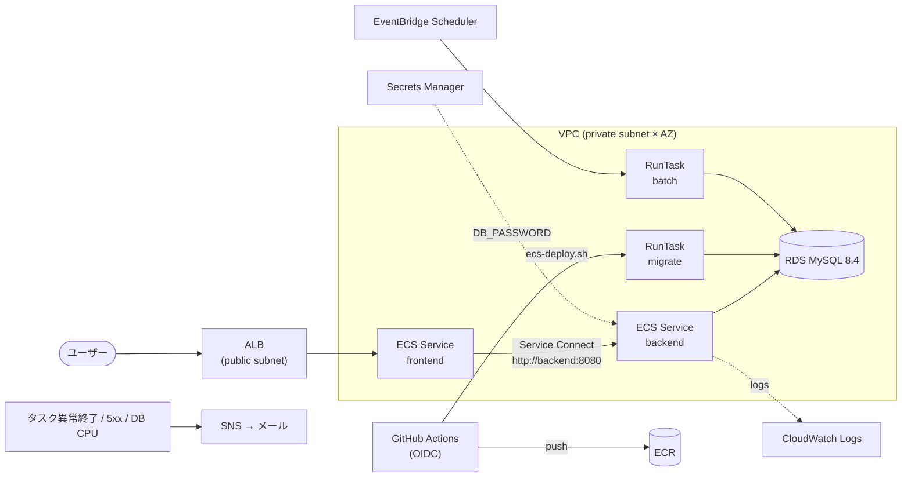

# AWS (ECS on Fargate)

`deploy/README.md` の「デプロイ契約」を AWS で実装する Terraform。



| スタック | 内容 | state |
|---|---|---|
| `shared/` | ECR (backend, frontend), GitHub OIDC プロバイダ, ビルド用ロール | 1 つ |
| `env/` | VPC, ALB, ECS (クラスタ・サービス・タスク定義), RDS, Secrets Manager, Scheduler, アラーム, デプロイ用ロール | 環境ごと |

## 初回セットアップ
前提: Terraform 1.10+, AWS CLI, 管理者権限の認証情報, state 用 S3 バケット

```bash
cd infra/aws
cp backend.hcl.example backend.hcl   # バケット名を設定

# 1) shared
cd shared
terraform init -backend-config=../backend.hcl -backend-config="key=voiler/shared.tfstate"
terraform apply -var github_repository=OWNER/REPO

# 2) 初回イメージを ECR に push (タスク定義が参照するため。以後は CD が行う)
#    tag は env の image_tag (既定 latest) と合わせる
aws ecr get-login-password | docker login --username AWS --password-stdin <account>.dkr.ecr.<region>.amazonaws.com
docker build -t <ecr>/voiler/backend:latest backend && docker push <ecr>/voiler/backend:latest
docker build -t <ecr>/voiler/frontend:latest frontend && docker push <ecr>/voiler/frontend:latest
#    ※ ECR は IMMUTABLE のため latest は初回のみ push 可能

# 3) env (staging)
cd ../env
# envs/staging.tfvars の github_repository / github_oidc_provider_arn を設定
terraform init -backend-config=../backend.hcl -backend-config="key=voiler/staging.tfstate"
terraform apply -var-file=envs/staging.tfvars
# 4) 初回マイグレーション: 以後は CD が実行する。最初だけ手動で
#    deploy/aws/ecs-deploy.sh を BACKEND_IMAGE/FRONTEND_IMAGE=...:latest で実行
```

## GitHub の設定
| 種類 | 名前 | 値 |
|---|---|---|
| Repository variable | `DEPLOY_TARGET` | `aws-ecs` |
| Repository variable | `AWS_REGION` | 例 `ap-northeast-1` |
| Repository variable | `AWS_BUILD_ROLE_ARN` | `shared` の出力 `build_role_arn` |
| Repository variable | `ECR_REGISTRY` | `<account>.dkr.ecr.<region>.amazonaws.com` |
| Environment `staging` / `production` の variables | `AWS_DEPLOY_ROLE_ARN`, `ECS_CLUSTER`, `ECS_NAME_PREFIX`, `ECS_SUBNETS`, `ECS_SECURITY_GROUP` | `env` の出力 `github_environment_variables` |
| Environment `production` | Required reviewers | 承認者を設定 (本番デプロイを承認制に) |

秘密情報 (アクセスキー等) は GitHub に置かない。OIDC で一時的な認証情報を取得する。

## 設計上の判断
| 項目 | 選択 | 理由 |
|---|---|---|
| 実行基盤 | ECS Fargate | Docker イメージをそのまま使える。サーバ管理不要。バッチに 15 分制限なし |
| backend の名前解決 | Service Connect | `API_ORIGIN=http://backend:8080` を compose / k8s と共通にできる。backend を外部公開しない |
| DB パスワード | random_password → Secrets Manager → `DB_PASSWORD` | RDS 管理パスワードは自動ローテーションで起動済みタスクの接続が切れるため不採用。代わりに state を厳重に管理する |
| マイグレーション | CD から RunTask (`api migrate`)、成功時のみサービス更新 | 複数台同時起動での競合と、失敗時の部分デプロイを避ける |
| イメージ | ECR (IMMUTABLE, sha タグ) | 同じイメージを staging → production へ昇格 |
| タスク定義 | 初回のみ Terraform、以後 CD が新リビジョン登録 (`ignore_changes`) | アプリのデプロイとインフラ変更を分離 |
| CPU アーキテクチャ | X86_64 | GitHub Actions の標準ランナーでビルドするため。Graviton (ARM64) にする場合はマルチアーキテクチャビルドが必要 |

## 費用の目安になる主な要素
NAT Gateway (台数 × 時間 + 転送量), ALB, Fargate (vCPU・メモリ × 時間), RDS (インスタンス + ストレージ + Multi-AZ)。
staging は `nat_gateway_count = 1`・Single-AZ・タスク 1 台にして抑えている。

## 未対応 (必要に応じて追加)
- WAF / CloudFront、Route 53 レコード (ALB の DNS 名に CNAME/エイリアスを向ける)
- VPC エンドポイント (ECR / Logs / Secrets Manager。NAT の転送量を減らす)
- アプリ専用の DB ユーザー (マスターユーザーの利用をやめる)
- RDS Proxy (Lambda 化やタスク数の大幅増加時)
- `terraform plan` の CI 実行 (要 AWS 認証)。現状は fmt / validate のみ
